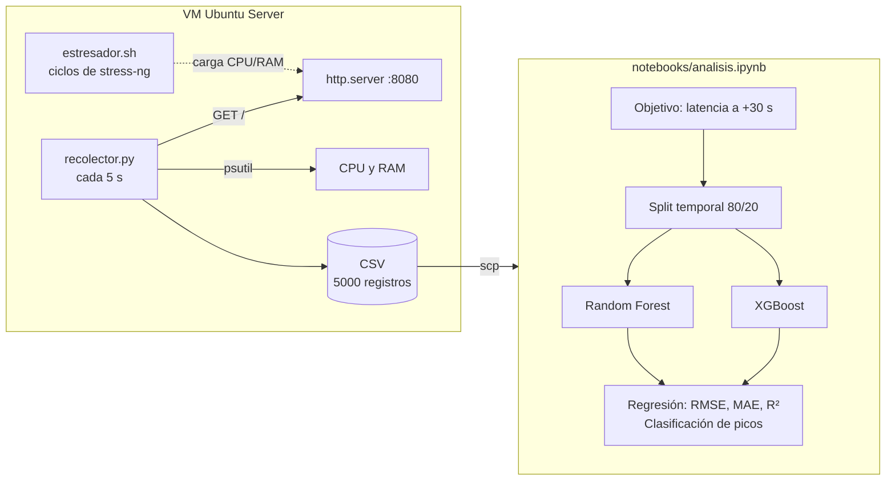
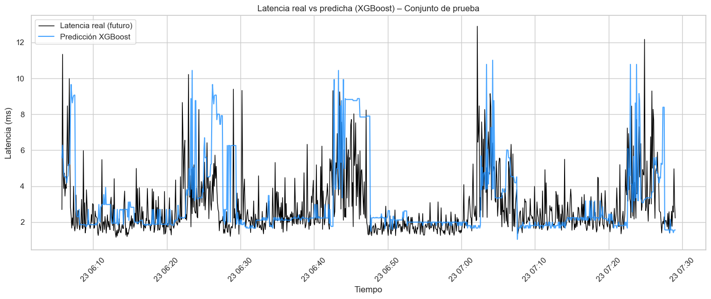

# Predicción de latencia en servidores con Machine Learning

| | |
|---|---|
| **Problema** | El monitoreo de servidores suele ser reactivo: la alerta llega cuando la CPU o la RAM ya están saturadas y los usuarios ya notan la lentitud. ¿Se puede anticipar un pico de latencia a partir del consumo de recursos? |
| **Resultado clave** | **No, con métricas instantáneas de CPU y RAM.** Random Forest y XGBoost obtuvieron un R² negativo (−0.23 y −0.71) al predecir la latencia a 30 s. El mejor detector de picos (XGBoost) acertó solo 11 de 41 (recall 0.27). |
| **Tecnologías** | Python 3.13 · psutil · requests · pandas · scikit-learn · XGBoost · matplotlib · seaborn · Jupyter · stress-ng · Ubuntu Server (VM) |

## Contexto

Proyecto de investigación realizado en la **Universidad Mundo Maya** en 2026 (entregado en junio). Título del documento final: *"Predicción de latencia en servidores mediante algoritmos de Machine Learning basados en el consumo de recursos"*.

El documento final no está publicado; este repositorio contiene el código, los datos y el análisis completos.

## Pregunta de investigación e hipótesis

**Pregunta.** ¿De qué manera un modelo de Machine Learning supervisado permite predecir los picos de latencia de un servidor a partir del historial de consumo de CPU y memoria RAM?

**Hipótesis.** Un modelo supervisado permite predecir los picos de latencia de un servidor a partir del historial de consumo de CPU y RAM.

**Objetivo.** Evaluar si Random Forest y XGBoost, entrenados con datos históricos de CPU y RAM, pueden predecir la latencia futura con **30 segundos de antelación** en un entorno controlado.

## Metodología

**Entorno.** Máquina virtual dedicada con Ubuntu Server, con 2 vCPU y ~1.6 GB de RAM (la RAM, calculada a partir de los datos registrados). Como servicio a medir se usó un servidor web mínimo, `python3 -m http.server 8080`.

**Recolección.** Se usaron dos procesos en paralelo, cada uno en su propia sesión SSH:

- [`src/recolector.py`](src/recolector.py): cada 5 s registra el uso de CPU y RAM (con `psutil`) y la latencia de una petición HTTP a `127.0.0.1:8080` (con `requests`). Se detiene a los 5000 registros.
- [`src/estresador.sh`](src/estresador.sh): repite ciclos de 20 min. Cada ciclo tiene 10 min de reposo, 5 min de estrés con `stress-ng --cpu 4 --vm 2 --vm-bytes 1G` y 5 min de recuperación. El propio servidor funciona como su grupo de control.

Se descartó medir la latencia con ping ICMP a `127.0.0.1`. El kernel gestiona la interfaz de loopback, así que el ping no refleja la saturación de la CPU en espacio de usuario.

Resultado de la recolección: **5000 registros** a lo largo de unas 7 horas, el 23 de mayo de 2026, durante los cuales se ejecutaron 21 ciclos de estrés.

**Modelado** ([`notebooks/analisis.ipynb`](notebooks/analisis.ipynb)):

- **Variables:** `CPU_Percent`, `RAM_Utilizada_MB`, `RAM_Libre_MB`, `RAM_Percent` y `Timestamp_Num`.
- **Objetivo:** la latencia 30 s en el futuro, es decir, desplazada 6 muestras. Quedan 4994 filas válidas.
- **División temporal:** el 80 % más antiguo para entrenamiento (3995 registros) y el 20 % más reciente para prueba (999 registros).
- **Modelos:** Random Forest (100 árboles) y XGBoost (100 árboles, `learning_rate=0.1`).
- **Picos:** se considera pico una latencia futura mayor que la media + 2σ del conjunto de entrenamiento, lo que da un umbral de **6.54 ms**.



## Resultados

Las cifras son **reproducibles**. El notebook se volvió a ejecutar desde cero con un kernel nuevo y todas las métricas coinciden con las reportadas en la investigación, salvo el R² de Random Forest a 5 s. Este da −0.3281, que redondea a −0.33, y el documento lo reporta como −0.32 por una diferencia de redondeo.

**Regresión: latencia a 30 s.** La desviación estándar de la latencia futura en el conjunto de prueba es de 1.64 ms.

| Modelo | RMSE (ms) | MAE (ms) | R² |
|---|---|---|---|
| Random Forest | 1.82 | 1.21 | −0.23 |
| XGBoost | 2.14 | 1.31 | −0.71 |



*Latencia real (negro) y predicha por XGBoost (azul) en el conjunto de prueba: el modelo sigue la tendencia general, pero no anticipa ni la magnitud ni el momento de los picos.*

**Horizonte de predicción (Random Forest).**

| Horizonte | RMSE (ms) | R² |
|---|---|---|
| 5 s | 1.88 | −0.33 |
| 10 s | 1.90 | −0.35 |
| 30 s | 1.82 | −0.23 |

**Clasificación de picos** (umbral de 6.54 ms; 41 picos reales en 999 muestras de prueba).

| Modelo | Precisión | Recall | F1 | Accuracy |
|---|---|---|---|---|
| XGBoost sin balanceo | 0.12 | 0.27 | 0.16 | 0.89 |
| Random Forest con `class_weight="balanced"` | 0.00 | 0.00 | 0.00 | 0.95 |

La matriz de confusión de XGBoost es `[[876, 82], [30, 11]]`. El modelo detecta 11 de los 41 picos y da 82 falsas alarmas. El 0.95 de accuracy del modelo balanceado es engañoso: se debe a que predice "normal" en casi todos los casos.

**Importancia de las variables.** `CPU_Percent` es la variable más influyente: 38 % en Random Forest y 63 % en XGBoost. `Timestamp_Num` pesa entre el 8 % y el 10 %. Todas las correlaciones con la latencia futura son débiles (|r| < 0.3).

## Conclusión

**La hipótesis se refutó** bajo las condiciones de este experimento. Los dos modelos predicen peor que un modelo que siempre devuelve la media (R² < 0). Acortar el horizonte a 5 o 10 s no mejora los resultados, y balancear las clases elimina por completo la detección de picos.

No es un fracaso del experimento: es un resultado negativo que delimita cuándo funciona este enfoque. El estudio identifica tres causas:

1. **Señal de degradación débil.** El servidor HTTP mínimo (`http.server`) apenas aumentaba su tiempo de respuesta, incluso con la CPU al 100 %. *(Nota: en términos relativos la latencia sí aumentó; ver el matiz en [Lo que aprendí](#lo-que-aprendí-auditoría-posterior).)*
2. **Variables estáticas.** Los modelos solo ven valores instantáneos de CPU y RAM. No tienen tendencias, medias móviles ni la fase del ciclo de estrés.
3. **Periodicidad sin codificar.** Los ciclos de 20 min son deterministas, pero ninguna variable lo refleja. `Timestamp_Num` no captura esa periodicidad.

En resumen, disponer de métricas de CPU y RAM no basta para predecir la latencia. Hace falta una señal de degradación más clara y variables que describan la dinámica del sistema.

## Lo que aprendí: auditoría posterior

Meses después audité el proyecto con ayuda de Claude Code. La auditoría de código completa está documentada en [docs/AUDITORIA.md](docs/AUDITORIA.md). Además de las causas que señala el estudio, encontré problemas de diseño que hoy resolvería de otra forma:

- **`Timestamp_Num` como predictor.** Con una división temporal, todos los timestamps de prueba son posteriores a los de entrenamiento. Los árboles no extrapolan, así que la variable no puede generalizar y solo agrega ruido. Lo correcto habría sido usar variables cíclicas, como la posición dentro del ciclo de estrés.
- **Timeouts guardados como 0 ms.** Si la petición HTTP fallaba o tardaba más de 2 s, el recolector registraba una latencia de `0.0`. Justo los peores casos, los que se querían predecir, habrían quedado como la mejor latencia posible. En el dataset analizado no hay ningún `0.0`, pero en una corrida posterior, probablemente con el servidor detenido, todas las latencias quedaron en `0.0 ms`.
- **Faltaba un baseline y faltaban lags.** No se comparó con el modelo trivial de persistencia ("la latencia en 30 s será igual a la actual"). Tampoco se usó la latencia actual ni sus valores pasados como variables. Sin ese punto de referencia, un R² negativo no dice si falla el modelo o los datos.

Y un hallazgo que matiza la conclusión del estudio: **la latencia sí se degradó bajo estrés.** La mediana es de **4.26 ms** en las muestras con CPU ≥ 90 %, frente a **1.69 ms** en el resto: unas **2.5 veces más**. El máximo observado fue de 35.28 ms. El cambio relativo es claro aunque en valores absolutos sea de pocos milisegundos. Mi hipótesis para la versión 2 es que la señal existía y que parte del problema estuvo en cómo se representó para el modelo, sin lags ni fase del ciclo.

## Cómo ejecutarlo

**Análisis** (Windows; en Linux o macOS, activa el entorno con `source venv/bin/activate`):

```powershell
python -m venv venv
venv\Scripts\activate
pip install -r requirements.txt -r requirements-dev.txt
jupyter execute --inplace notebooks/analisis.ipynb
```

También puedes abrir el notebook en Jupyter o VS Code y ejecutar todas las celdas. Lee `data/raw/registro_rendimiento2.csv`.

**Recolección** (en una VM Linux con `stress-ng` instalado):

```bash
sudo apt install stress-ng python3-psutil python3-requests
python3 -m http.server 8080 &
cd src
python3 recolector.py      # terminal 1
bash estresador.sh         # terminal 2
```

> **Importante:** `recolector.py` se ejecuta desde `src/` y **sobrescribe** `data/raw/registro_rendimiento.csv` cada vez que arranca. Respalda o renombra el CSV antes de una nueva corrida.

## Estructura del repositorio

```
├── data/raw/
│   ├── registro_rendimiento2.csv   # dataset analizado (HTTP, 5000 registros)
│   └── registro_rendimiento.csv    # primera corrida con ping ICMP, descartada
├── docs/
│   ├── img/                        # figuras usadas en este README
│   ├── AUDITORIA.md                # auditoría de código posterior
│   ├── BITACORA.md                 # historia del proyecto reconstruida desde git y los datos
│   └── CONTEXTO_INVESTIGACION.md   # resumen del documento final y sus discrepancias con el código
├── notebooks/
│   └── analisis.ipynb              # análisis completo, con salidas
├── src/
│   ├── recolector.py               # telemetría de CPU, RAM y latencia HTTP
│   └── estresador.sh               # ciclos de estrés con stress-ng
├── CLAUDE.md                       # contexto del proyecto para Claude Code
├── LICENSE                         # licencia MIT
├── README.md
├── requirements.txt                # dependencias del análisis
└── requirements-dev.txt            # herramientas para ejecutar el notebook por línea de comandos
```

## Trabajo futuro (versión 2)

- **Señal más realista:** reemplazar `http.server` por Nginx o Apache con contenido dinámico y tráfico concurrente simulado.
- **Variables dinámicas:** tasas de cambio, medias móviles, lags de latencia y la fase del ciclo, además de métricas como I/O wait y conexiones activas.
- **Evaluación más sólida:** baseline de persistencia y validación con `TimeSeriesSplit` en lugar de un único split.
- **Recolector más robusto:** registrar los errores y timeouts como tales, no como 0, y no sobrescribir datasets anteriores.
- **Otros modelos:** series temporales (LSTM, Transformers) y detección de anomalías no supervisada.
- **Escenario más cercano a producción:** contenedores Docker y patrones de carga irregulares.

## Licencia

[MIT](LICENSE) © 2026 Leonidas Díaz Flores
